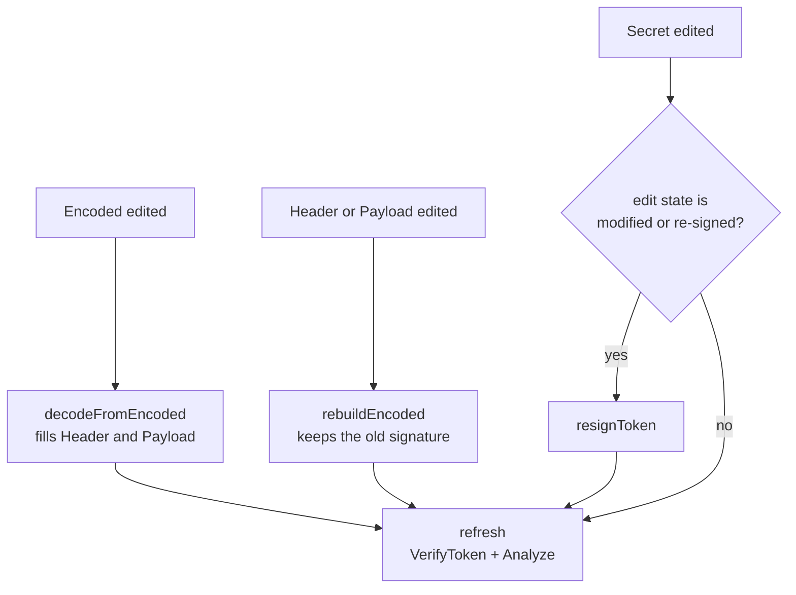

# Architecture

Packages of `jwt-tui` and the path of a keystroke through them.

## Packages

| Package | Role |
| --- | --- |
| `cmd/jwt-tui` | Flags, config loading, print mode. `version` is set at build time with `-ldflags "-X main.version=..."`. |
| `internal/jwt` | Parsing, key resolution, verification, signing, claim checks. No TUI dependency. |
| `internal/report` | Print mode: runs `jwt` on one token and renders text or JSON, computes the exit code. |
| `internal/ui` | Bubble Tea model, update loop, views, external editor. Embeds `docs.md`, the in-app reference. |
| `internal/config` | YAML config. Only keybindings. Defaults come from the embedded `default_config.yaml`. |
| `internal/keys` | Turns the config into `key.Binding` values and help text. |
| `internal/highlight` | Colors JSON and the three-part token. |
| `internal/style` | Panel borders and titles. |

```mermaid
flowchart LR
    main["cmd/jwt-tui"] --> config["internal/config"]
    main --> report["internal/report"]
    main --> ui["internal/ui"]
    config --> keys["internal/keys"]
    keys --> ui
    ui --> jwt["internal/jwt"]
    report --> jwt
    ui --> highlight["internal/highlight"]
    ui --> style["internal/style"]
```

`--print` and `--json` never reach `internal/ui`: `main` calls `report.Analyze` and exits.

## Panels

The TUI has four panels, indexed `panelEncoded`, `panelHeader`, `panelPayload`, `panelSecret` (`internal/ui/model.go`). Each holds a textarea and a viewport. A status bar shows signature state, temporal state and edit state (`original`, `modified`, `re-signed`).

## Flow of a change

`onContentChange` in `internal/ui/update.go` acts on the panel that changed, then `refresh` runs `jwt.VerifyToken` and `jwt.Analyze` on the Encoded and Secret texts.



Consequence: once a token has been modified, editing the Secret panel re-signs it immediately, and the state becomes `valid (self-signed)` if the key can sign.

A one-second timer (`temporalTick`) refreshes the temporal state so expiry shows without input.

## Verification

`jwt.VerifyToken` returns a `VerifyResult` with the signature state and key metadata. It checks, in order: three parts, base64url and JSON of the header, presence of `alg`, `none`, key resolution, algorithm confusion, plain string against an asymmetric algorithm, then the signature via `github.com/golang-jwt/jwt/v5` restricted to the token's own `alg` and without claims validation. Claims are evaluated separately by `EvaluateTemporal` and `Analyze`.
